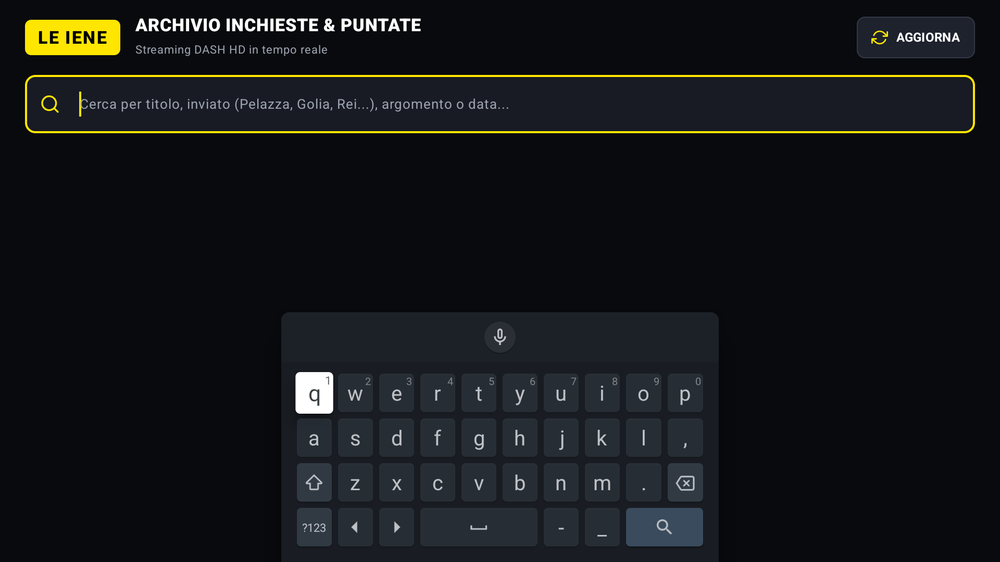

# Le Iene TV & Mobile

App Android nativa (Jetpack Compose + Media3 ExoPlayer) a tema **Le Iene** progettata per **Android TV** (10-foot UI, D-Pad, telecomando, banner Leanback) e **Mobile/Tablet** (touch).

Scansiona ed estrae i servizi e le puntate da `leiene.it`, risolvendo dinamicamente i manifest **MPEG-DASH** (`.mpd`) ad alta definizione (1080p) tramite backend ThePlatform / Mediaset CDN.

## Caratteristiche

- **Archivio Puntate & Servizi**: visualizzazione delle inchieste della giornata e delle puntate precedenti con scrolling progressivo.
- **Titoli & Descrizioni Complete**: metadati editoriali per ogni inchiesta con data di trasmissione e badge dell'inviato (Pelazza, Martinelli, Golia, Rei, Roma, ecc.).
- **Schede Uniformi & Compatte**: griglia con dimensioni fisse e allineamento perfetto sia su schermi TV 1080p/4K che su smartphone.
- **Barra di Ricerca Live**: filtro istantaneo per titolo, inviato, parola chiave o data.
- **Player Video Cinematografico**:
  - Riproduzione MPEG-DASH unencrypted HD senza interruzioni.
  - Icone vettoriali dedicate (Replay 10s circolare, Play/Pausa circolare, Forward 10s circolare).
  - Navigazione completa tramite telecomando (Enter, Frecce Left/Right, Back).
- **Ripresa Automatica Visione (Resume Playback)**:
  - Memorizzazione della posizione temporale interrotta.
  - Barra di avanzamento gialla sulle miniature dei video iniziati.
  - Finestra di dialogo alla riapertura: riprendi dal minuto esatto o ricomincia dall'inizio.

## Screenshot




## Installazione

È possibile installare direttamente il pacchetto compilato [`app-leiene.apk`](app-leiene.apk) tramite ADB:

```bash
# Connessione ad Android TV Box locale
./install_box_128.sh

# Oppure tramite adb standard
adb install -r app-leiene.apk
```

## Compilazione da Sorgente

Requisiti: Android SDK (API 36, build-tools 35+) e JDK 17 o 21.

```bash
./gradlew assembleDebug
```
L'APK generato si troverà in `app/build/outputs/apk/debug/app-debug.apk`.
